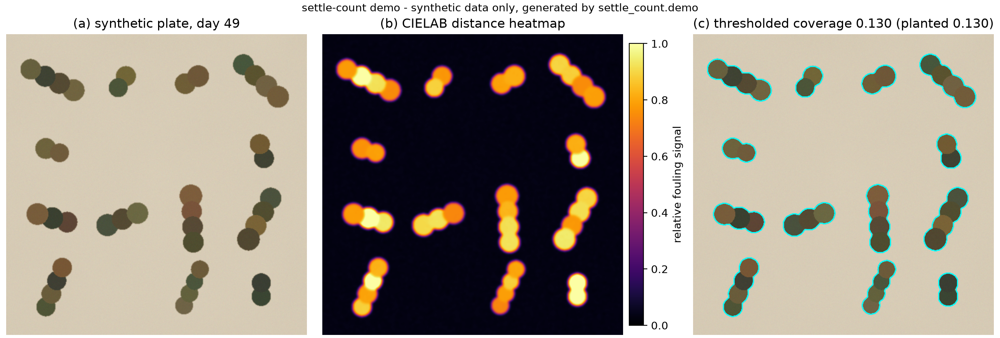
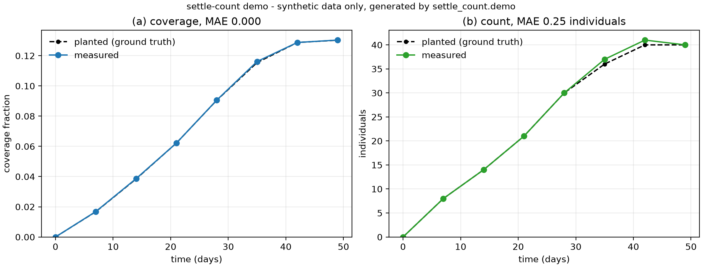

# settle-count

[](https://github.com/kfat77/settle-count/actions/workflows/tests.yml)

A small, dependency-light image-quantification tool for marine biofouling
settlement plates. From ordinary RGB photographs it answers three questions:

1. **How much of the surface is covered?** — coverage fraction and a per-pixel
   heatmap.
2. **How many individuals settled?** — a count, with touching individuals
   separated by a distance transform followed by a seeded watershed.
3. **How does coverage evolve over time?** — coverage (and count) against
   exposure time for a series of photographs of the same plate.

> **All images in this repository are synthetic.** They are rendered by
> `settle_count.demo`, which also records the planted coverage and count, so the
> tool can be scored against a known answer. No experimental data from any lab
> is included. `settle-count` is a quantification helper, not a validated
> measurement protocol.





## Why this exists

Antifouling field trials end with a deceptively simple question: did the coating
keep organisms off? For an in-situ sensor the answer is usually reduced to two
numbers — how many organisms settled, and how much of the surface they cover —
because those are what decide whether a housing stays readable.

Hao et al. (*International Biodeterioration & Biodegradation*, 2022,
[DOI 10.1016/j.ibiod.2022.105400](https://doi.org/10.1016/j.ibiod.2022.105400))
evaluated a camptothecin-based antifouling paint on six sensor housing materials
(316L stainless steel, TC4 titanium, 7075 aluminium, POM, PVC and PTFE), with
field exposure in Xiamen Wuyuan Bay over 3–9 months and in-situ sensors on a
Daya Bay buoy platform that stayed clean for more than four months. Turning the
recovered plates into those numbers still involves segmenting fouling from the
plate, splitting clumped individuals, and tracking coverage across exposure
time.

`settle-count` addresses only that quantification step. It was **not** used in
the paper above, it does not replace any lab protocol, and its accuracy on real
plates has not been validated — see [Limitations](#limitations).

## Install

Python 3.10 or newer; runtime dependencies are numpy, scipy, scikit-image and
matplotlib.

```bash
pip install .            # or: pip install -e .   (editable)
```

The demo script and the tests also run straight from a clone, without
installing, because they add `src/` to `sys.path`.

## Quick start

Generate the synthetic demo data and both figures:

```bash
python scripts/make_figures.py
```

Measure coverage and write a heatmap:

```bash
PYTHONPATH=src python -m settle_count coverage examples/synthetic/day_35.png --heatmap heat.png
```

Count settled individuals:

```bash
PYTHONPATH=src python -m settle_count count examples/synthetic/day_35.png
```

Measure a whole time series and save it as CSV:

```bash
PYTHONPATH=src python -m settle_count timeseries "examples/synthetic/day_*.png" --csv curve.csv
```

On Windows PowerShell, set the path first and quote the wildcard as shown:
`$env:PYTHONPATH="src"; python -m settle_count coverage examples/synthetic/day_35.png`.
After `pip install .` the `PYTHONPATH=src` prefix is no longer needed.

As a library:

```python
from settle_count import coverage_map, count_settled, coverage_timeseries

fraction, heat = coverage_map(image)          # image: (H, W, 3) RGB array
result = count_settled(image)                 # result.count, result.labels, result.areas
series = coverage_timeseries(["day_07.png", "day_14.png", "day_21.png"])
```

## How it works

### Coverage: a background colour, not a fixed threshold

The plate surface is modelled by one colour, estimated as the dominant colour of
the image (the most populated bin of a coarse RGB histogram; the returned value
is the median of that bin, which is robust to a scattered minority of fouled
pixels). Every pixel is then scored by its CIELAB colour distance (delta-E 1976)
from that background:

```
score(x, y) = sqrt( (L - L_bg)^2 + (a - a_bg)^2 + (b - b_bg)^2 )
```

CIELAB is used instead of raw RGB so that a single threshold means roughly the
same thing for dark barnacles and pale tube worms, and so that a change in lamp
brightness mostly shifts `L*` rather than rescaling every channel.

The score map is smoothed (Gaussian, 2 px by default), then thresholded with

```
threshold = max( Otsu(score in ROI),  median + 3 * 1.4826 * MAD,  3 delta-E )
```

Otsu's method separates the two colour populations when fouling is present. The
robust noise floor matters for the unfouled case: without it, Otsu would split
sensor noise in half and report ~50% coverage for a clean plate. The 3 delta-E
floor covers mild illumination gradients and camera noise, which sit well below
3 delta-E while settled organisms are tens of delta-E away. Both floors are
inactive once real fouling is present, because Otsu then dominates.

**Coverage is defined explicitly** as the fraction of analysed plate pixels
whose smoothed CIELAB distance from the estimated plate background exceeds that
threshold. It is not an area in mm² and it is not a biological classification:
biofilm, a barnacle and a scratch all count as "covered" if their colour differs
enough. The threshold actually used is returned by `analyze_coverage(...).threshold`
and printed by the CLI, and it can be fixed explicitly with `min_delta_e=` /
`--min-delta-e`, which is the parameter to quote when the number is reported.

The covered fraction is the fraction of analysed pixels above the threshold;
`heat` is the score normalised to [0, 1] by its 99th percentile, which is what
the colour map shows.

### Counting: distance transform + h-maxima seeds + watershed

1. Segment fouled pixels with the coverage step, fill holes, remove specks.
2. Compute the Euclidean distance transform (EDT) of the binary mask and smooth
   it with a 1 px Gaussian. Each individual contributes a local maximum at its
   centre; a clump of touching individuals has one maximum per member, joined by
   a saddle. The smoothing removes pixel-level ridges that would otherwise split
   a single round individual into two seeds.
3. Place one seed per individual as an h-maximum of the smoothed EDT. The depth
   is derived from the image itself — 8% of the 95th percentile of the EDT, i.e.
   roughly 8% of the typical object radius — so no absolute pixel threshold has
   to be guessed per image.
4. Run a seeded watershed on the negated EDT with the mask as the allowed
   domain. Every clump pixel is assigned to the peak basin it drains to, which
   is what turns "one connected blob" into "three individuals".
5. Drop labels smaller than 15% of the median object area (watershed slivers)
   and return the label image together with the per-individual pixel areas.

Connected-component counting without steps 2–4 would undercount every clump as
one individual; that is exactly the failure mode this pipeline exists to fix.

### Time series

`coverage_timeseries` reads a list of paths or a `{day: path}` mapping, runs the
coverage (and optionally counting) step on each frame, and returns a
column-oriented dict (`day`, `coverage`, `count`, `path`) sorted by time. When
no explicit days are given, the last number in each filename is used
(`siteA_day_21.tif` → 21); files without a number fall back to their position
in the sorted list. `write_coverage_csv` stores the table; nothing depends on
pandas.

## Validation on synthetic ground truth

`settle_count.demo` renders a 49-day settlement series (512 × 512 px, seed
20221105). Individuals arrive during the first 40 days and grow to a mature
radius of about 17.5 px. They are placed in clumps of 1–4 individuals, one clump
per cell of a 4×4 grid, with neighbouring members about 1.45 radii apart, i.e.
overlapping by roughly a quarter of their diameter. Because the planted union
mask and the planted count are known, the pipeline can be scored instead of
merely eyeballed. Running `python scripts/make_figures.py` prints:

```
 day  planted cov  measured    error  planted n  measured
   0        0.000     0.000   +0.000          0         0
   7        0.017     0.017   +0.000          8         8
  14        0.038     0.039   +0.000         14        14
  21        0.062     0.062   -0.000         21        21
  28        0.091     0.091   +0.000         30        30
  35        0.115     0.116   +0.001         36        37
  42        0.129     0.129   +0.000         40        41
  49        0.130     0.130   +0.000         40        40

coverage: mean absolute error 0.0001 (0.01 percentage points)
count:    mean absolute error 0.25 individuals
```

The count column is where the watershed earns its place: at day 49 a plain
connected-component count finds 13 blobs for the 40 planted individuals, and the
distance-transform/watershed step recovers 40. The demo is deterministic — the
same seed reproduces the same images and the same numbers — so every value above
can be regenerated with one command. The frames themselves are written to
`examples/synthetic/`, and the figures are regenerated from the same run.

## Limitations

These are real, and they matter for a research setting:

- **No validation on real plates.** All accuracy numbers above come from
  synthetic images whose appearance and difficulty were chosen by the same
  person who wrote the analyser; the demo is deliberately resolvable by the
  pipeline. Agreement on synthetic data says the implementation is internally
  consistent, not that it matches a marine biologist's counts.
- **One background colour.** If fouling covers more than roughly half the
  frame, the dominant colour becomes fouling and the estimate collapses; pass an
  explicit plate colour (`background=` / `--background R G B`) in that case.
  Water droplets, glare and shadows are counted as fouling.
- **No plate detection.** Crop tightly to the plate before analysis (or pass
  `roi=`); the tool does not find the plate, and the coverage denominator is the
  analysed frame area.
- **Splitting works best for round, similar-sized individuals.** Elongated or
  branching colonies can be over-split by the watershed; individuals that overlap
  by more than roughly a third of their diameter can merge into one seed and be
  under-counted. The area filter is a heuristic, not a classifier.
- **Pixels, not millimetres.** There is no scale calibration and no lens
  correction; the output is a pixel count and a fraction, not a density per unit
  area.
- **No deep learning and no colour calibration.** The method is a fixed,
  auditable image-processing pipeline. That is deliberate, but it also means
  unusual organisms or plate colours may need a different segmentation
  threshold (`--min-delta-e`) or an explicit background.

## Repository layout

```
src/settle_count/coverage.py    background estimate, delta-E score, threshold, heatmap
src/settle_count/counting.py    EDT, h-maxima seeds, seeded watershed, area filter
src/settle_count/timeseries.py  multi-frame measurement, CSV export
src/settle_count/demo.py        synthetic frames with planted ground truth
src/settle_count/__main__.py    command line interface (coverage / count / timeseries)
scripts/make_figures.py         demo run and figure generation
tests/test_settle_count.py      unit tests (unittest, no extra dependency)
docs/img/                       figures shown above
examples/synthetic/             generated demo frames (synthetic; regenerated by the script)
```

Run the tests with `python -m unittest discover -s tests -v`.

## Data and ethics

The demo data are synthetic; the generator is in `settle_count/demo.py` and every
image is labelled as synthetic in this README, in the figure titles and in the
module docstring. The repository ships no plate photographs from Xiamen Wuyuan
Bay, Daya Bay or any other field site. The citation of Hao et al. (2022) is
motivation for the *quantification* problem only; no result, image or protocol
from that paper is reproduced here.

## License

MIT — see [LICENSE](LICENSE). Citation metadata is in [CITATION.cff](CITATION.cff).
